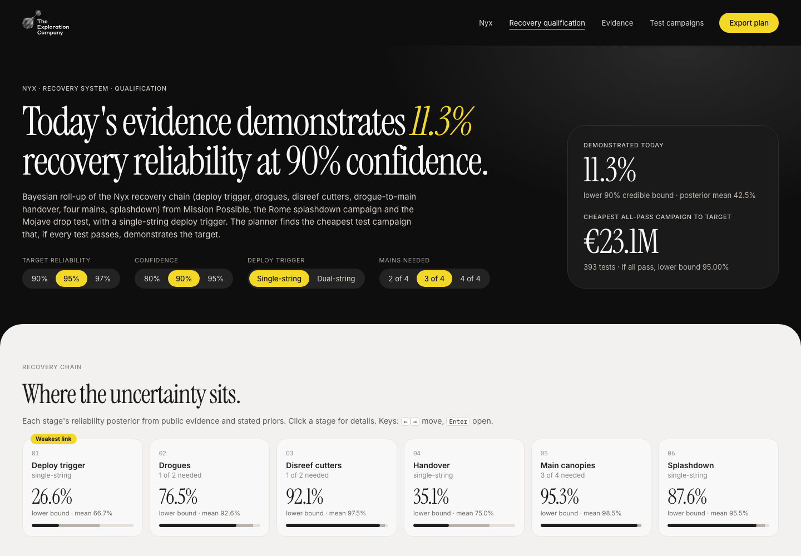

# Nyx Recovery Qualification Planner

**Live demo:** https://mohith26.github.io/tec-recovery-qualification/

After Mission Possible, TEC wrote that "the parachute system was not drop-tested; critical subsystems ran single-string", and Nyx now has to be qualified with NASA and ESA for ISS cargo. This tool answers two questions a recovery team gets asked constantly: **how reliable has the evidence shown the recovery chain to be**, and **what is the cheapest test campaign that would demonstrate a target** (e.g. 95% at 90% confidence)? It rolls public evidence (Mission Possible, the Rome splashdown tank campaign, the May 2026 Mojave drop test) up through the recovery chain with redundancy, finds the weakest link, and solves for the cheapest all-pass campaign exactly over a test menu. It also shows what redundancy buys: a dual-string deploy trigger.



*Unofficial concept demo by Mohith Gajjela. Not affiliated with The Exploration Company. Evidence is public; priors, architecture details and test costs are stated assumptions you can change.*

## Results (from `data/results.json`, 90% confidence, default assumptions)

| | Single-string trigger | Dual-string trigger (β = 0.1) |
|---|---|---|
| Demonstrated today (lower 90% bound) | 11.3% (mean 42.5%) | 17.1% (mean 51.3%) |
| Weakest link | deploy trigger | drogue-to-main handover |
| Cheapest all-pass campaign to 90% | €8.8M | €7.4M |
| **Cheapest all-pass campaign to 95%** | **€19.6M** (5 drops, 44 handover tests, 24 mortar, 16 cutter pairs, 51 water impacts, 167 trigger HIL) | **€16.6M** (4, 44, 24, 16, 45, 46) |
| Cheapest all-pass campaign to 97% | €37.8M | €30.7M |

Headline: making the deploy trigger dual-string cuts the cheapest campaign that demonstrates 95% recovery reliability at 90% confidence by **15%** (€19.6M → €16.6M) under the assumed unit costs. The "clean sweep odds" for these plans are tiny under today's evidence, which is itself the finding: the trigger and the handover need fix-and-retest work before a demonstration campaign makes sense.

## How it works (`core/qual.js`, `core/model.js`)

1. **Chain model:** six stages in series: deploy trigger (single or dual-string with a β-factor common cause), drogues (mortar + canopy, 1 of 2), disreef cutters (1 of 2), handover, mains (k of 4), splashdown. Each element has a Beta posterior from a prior plus weighted public evidence.
2. **Exact moments:** every stage's reliability is a polynomial in its elements' success probabilities, so E[R] and E[R²] are exact sums of Beta moments; stages multiply. The system lower credible bound comes from a moment-matched Beta (checked against Monte Carlo in tests: within 1 point at the plan targets).
3. **Cheapest all-pass campaign:** integer test counts minimise cost subject to "if every test passes, the bound ≥ target". The solver enumerates every grid combination of the first five test types (pruned by cost) and binary-searches the last, using monotonicity; stage moments are memoised by the counts that touch each stage. A randomized test checks it against brute force.
4. **Clean-sweep odds:** the posterior predictive probability that every planned test passes (product of Beta-binomial terms).
5. **App:** TEC's web design system (black hero, light content, yellow pills, condensed serif headlines). Controls for target, confidence, trigger architecture and mains needed; recovery-chain cards with a weakest-link flag; stage drawer with posterior densities and what one more pass or failure is worth; campaign table; cost-of-confidence chart (single vs dual); an editable evidence ledger where you can log new test results (saved in localStorage). Export JSON/CSV. Deep links `#target=0.95&conf=0.9&trig=dual&mains=3&stage=handover`. Keys: ←/→, Enter, Esc, D, E.

## Tests

`node --test tests/core.test.mjs` (12 tests, GitHub Actions): incomplete-beta closed forms and inversion, k-of-n and dual-string polynomials, exact moments vs Monte Carlo (randomized), moment-matched bound vs Monte Carlo at the plan targets, evidence weighting, monotonicity of the bound in passes and failures (property), redundancy helps, Beta-binomial clean-sweep probability, **solver equals brute force on random instances (property)**, **stored plans and the 15% headline reproduced by the app pipeline**, the success-run rule (230 straight successes for 99% at 90%), and the weakest link.

## Run it

```
python3 -m http.server          # open http://localhost:8000
node scripts/build_data.mjs     # rebuild data/results.json (about 4 s)
node --test tests/core.test.mjs
```

## Limitations

- TEC has not published the Mission Possible root cause; counting it as one deploy-trigger failure at quarter weight (because TEC says lessons were implemented on Nyx) is my assumption and is adjustable in the ledger.
- Priors (Jeffreys for TEC-built items, a 10-use heritage prior for the Airborne Systems canopies), the β = 0.1 common-cause factor, the test menu and all unit costs are illustrative assumptions, not TEC numbers.
- Elements are independent and identical units share one success probability; real qualification also leans on analysis, margins and environment coverage, which a pass/fail model does not capture.
- The plan is optimal over the test grid (step sizes and maxima are listed in `core/model.js`); at 97% the water-impact count sits at its grid maximum.
- All-pass planning is the classic success-run approach; a fuller version would optimise expected assurance allowing failures.

## Prior art / novelty

Bayesian reliability demonstration testing and system roll-ups are established methods (e.g. NASA and DoD reliability literature, success-run testing). I found no public TEC material describing a quantitative recovery-qualification planner, and no tool that couples a redundancy-aware recovery-chain roll-up with an exact cheapest-campaign solver and an editable evidence ledger. Checked: exploration.space blog (Mission Possible updates, water-impact tests, drop test), TEC Series C release, SmallSat 2025 poster, IAC 2022-2025 TEC abstracts, coverage in European Spaceflight, Payload, Ars Technica and SpaceNews.

## Sources

Mission Possible outcome and design trade-offs: exploration.space blog (30 Jun 2025) and Hélène Huby interview (European Spaceflight, Nov 2025). Water-impact tests: exploration.space (5 Feb 2026). Drop test: exploration.space (4 Jun 2026; Matt Darley's write-up).
